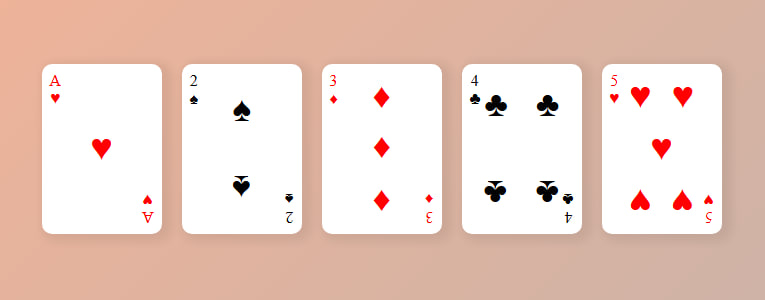

# RoyalGrid

An **interactive playing cards layout project** built as part of the **Responsive Web Design Certification curriculum** by *[freeCodeCamp](https://www.freecodecamp.org/learn/responsive-web-design-v9/lab-page-of-playing-cards/build-a-page-of-playing-cards)*. This application models a set of stylized playing cards using advanced CSS Flexbox properties, layout positioning, and responsive design techniques.

---



---

## Key Features

* **Component Styling & Positioning :** Uses advanced CSS properties (`display: flex`, `justify-content`, and transforms) to accurately structure card faces, suits, and corner values.
* **Responsive Layout Design :** Integrates flex-wrap and fluid container sizing (`flex-wrap: wrap`, `min-height: 100dvh`) to dynamically adapt the card layout across different screen sizes.
* **Visual Effects & Interactions :** Applies smooth gradients (`linear-gradient`) and subtle drop shadows (`box-shadow`) to simulate the physical relief and depth of real playing cards.

---

## Concepts & Technologies Applied

* **HTML5 :** Semantic page structure (`<main>`, `<div>`) and integration of card symbols and elements.
* **CSS3 :** Box model (`box-sizing`), precise positioning, flexbox layout management, and transformations (`transform: rotate`).
* **Responsive Web Design :** Fluid alignments, adaptive units (`dvh`), and flexible grid/flex wrapping.
* **Advanced Selectors :** Utilization of pseudo-classes (`:nth-of-type`) for targeted card styling and orientation.

---

## Code Structure Example

Excerpt from the stylesheet managing the main layout container and individual card components :

```css
.playing-cards {
  display: flex;
  flex-wrap: wrap;
  justify-content: center;
  align-items: center;
  gap: 20px;
  padding: 40px;
}

.card {
  display: flex;
  justify-content: space-between;
  width: 120px;
  height: 170px;
  background-color: #fff;
  padding: 8px;
  border-radius: 10px;
  box-shadow: 5px 3px 10px 5px #00000011;
}

.card .middle {
  display: flex;
  justify-content: space-around;
  align-items: space-evenly;
  flex-wrap: wrap;
}
